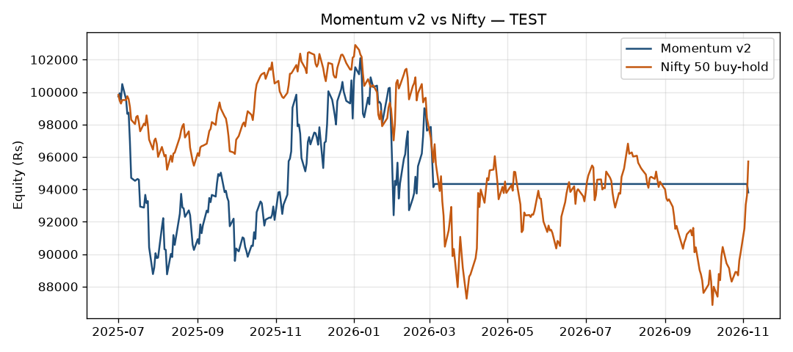

# Phase 2 backtest comparison

Capital Rs 1,00,000. All figures after Angel One cash-market costs
(Rs 20 brokerage per order, STT, stamp, exchange, SEBI, GST, 0.05% slippage).
Only the TEST window decides. Parameters were not tuned after seeing TEST.

## Windows

- Momentum TRAIN 2024-01 → 2024-12, VALIDATE 2025-01 → 2025-06, TEST 2025-07 → 2026-11.
- ORB has no TRAIN (15m history starts 2025-08). VALIDATE 2025-08 → 2026-02, TEST 2026-03 → 2026-11.
- ORB skips `backtest_ok=false` days and hard-exits at the 15:00 15-minute bar close.

## Results

| strategy | window | CAGR | Sharpe | max DD | win rate | profit factor | trades | cost % of gross | end equity |
|---|---|---:|---:|---:|---:|---:|---:|---:|---:|
| momentum | TRAIN | 6.25% | 0.43 | -11.02% | 50.00% | 4.89 | 16 | 11.4% | 106146 |
| nifty | momentum-TRAIN | 9.11% | 0.69 | -10.95% | 100.00% | inf | 1 | 4.0% | 108769 |
| momentum | VALIDATE | 10.67% | 0.63 | -14.94% | 41.67% | 1.53 | 12 | 3.5% | 104862 |
| nifty | momentum-VALIDATE | 15.53% | 1.05 | -8.72% | 100.00% | inf | 1 | 4.9% | 107110 |
| momentum | TEST | -12.71% | -0.70 | -25.23% | 25.00% | 0.29 | 32 | 6.5% | 83296 |
| nifty | momentum-TEST | -3.11% | -0.18 | -15.59% | 0.00% | 0.00 | 1 | 8.8% | 95719 |
| orb | VALIDATE | -74.26% | -5.38 | -56.15% | 35.79% | 0.55 | 366 | 34.3% | 44723 |
| nifty | orb-VALIDATE | 4.10% | 0.46 | -5.72% | 100.00% | inf | 1 | 14.2% | 102142 |
| orb | TEST | -70.55% | -3.95 | -59.13% | 39.63% | 0.64 | 434 | 25.1% | 43222 |
| nifty | orb-TEST | -2.24% | -0.07 | -10.61% | 0.00% | 0.00 | 1 | 26.4% | 98327 |

## Verdict

Gate: TEST window only — beat Nifty CAGR after costs, Sharpe > 0.8, max DD < 20%.

Momentum TEST: FAIL. CAGR -12.71% vs Nifty -3.11% (does not beat); Sharpe -0.70 <= 0.8; max DD -25.23% >= 20%.
ORB TEST: FAIL. CAGR -70.55% vs Nifty -2.24% (does not beat); Sharpe -3.95 <= 0.8; max DD -59.13% >= 20%.

Verdict: neither strategy clears the TEST gate. A negative result is the result.

## Iteration 1 — Momentum v2

Universe: Nifty Next 50 plus the original 5 names (~55 CNC names). Rank 90-day return
minus last-5-day return. Hold top 5 equal weight, rebalance every 21 sessions,
drop names below rank 8. If Nifty 50 close is below its 200-day SMA on a rebalance day,
flatten to cash until it closes back at or above the SMA. Long-only, no leverage.
Same costs and TEST gate. Parameters were not tuned after seeing TEST.

| strategy | window | CAGR | Sharpe | max DD | win rate | profit factor | trades | cost % of gross | end equity |
|---|---|---:|---:|---:|---:|---:|---:|---:|---:|
| momentum_v2 | TRAIN | -9.45% | -0.32 | -21.96% | 40.00% | 0.56 | 40 | 7.2% | 90697 |
| nifty | momentum_v2-TRAIN | 9.11% | 0.69 | -10.95% | 100.00% | inf | 1 | 4.0% | 108769 |
| momentum_v2 | VALIDATE | -5.54% | -0.24 | -12.86% | 35.00% | 0.78 | 20 | 8.0% | 97258 |
| nifty | momentum_v2-VALIDATE | 15.53% | 1.05 | -8.72% | 100.00% | inf | 1 | 4.9% | 107110 |
| momentum_v2 | TEST | -4.50% | -0.24 | -11.68% | 33.33% | 0.71 | 45 | 8.5% | 93806 |
| nifty | momentum_v2-TEST | -3.11% | -0.18 | -15.59% | 0.00% | 0.00 | 1 | 8.8% | 95719 |

TEST days in cash (no holdings, including regime filter): 49.6% (166 / 335 sessions).

Momentum v2 TEST: FAIL. CAGR -4.50% vs Nifty -3.11% (does not beat); Sharpe -0.24 <= 0.8; max DD -11.68% < 20%.

TEST days in cash (no holdings, including regime filter): 49.6% (166 / 335 sessions).

Verdict: Momentum v2 does not clear the TEST gate. Stop momentum here; do not tune parameters.

## Iteration 2 — HARMONIC-XABCD

Pre-registered 15-minute XABCD harmonics (ZigZag 2% for the TEST decision).
Conservative choices: ±0.05 XB/XD; C beyond A is Group 2; coverage-false days dropped before ZigZag;
entry on the first close in the PRZ after the confirmation bar; same-bar stop beats target;
20% equity notional, no leverage; Rs 20 flat MIS brokerage from costs.py (not min(Rs 20, 0.03%)).
Universe: RELIANCE, HDFCBANK, INFY, TCS, SBIN. Skip `backtest_ok=false` days.
MIS costs from `backtest/costs.py`. Shorts modelled as cash-market MIS.

### Metrics (2% ZigZag)

| strategy | window | CAGR | Sharpe | max DD | win rate | profit factor | trades | cost % of gross | end equity |
|---|---|---:|---:|---:|---:|---:|---:|---:|---:|
| harmonic-2pct | VALIDATE | -1.24% | -2.42 | -1.53% | 0.00% | 0.00 | 8 | 94.2% | 98473 |
| nifty | harmonic-VALIDATE | 4.10% | 0.46 | -5.72% | 100.00% | inf | 1 | 14.2% | 102142 |
| harmonic-2pct | TEST | -1.85% | -2.97 | -2.28% | 6.25% | 0.03 | 16 | 94.6% | 97716 |
| nifty | harmonic-TEST | -2.24% | -0.07 | -10.61% | 0.00% | 0.00 | 1 | 26.4% | 98327 |

### Pattern-type breakdown (2%, VALIDATE + TEST combined)

| pattern | trades | wins | losses | net P&L | profit factor |
|---|---:|---:|---:|---:|---:|
| Alt Shark | 2 | 0 | 2 | -468 | 0.00 |
| Bat | 1 | 0 | 1 | -46 | 0.00 |
| Butterfly | 3 | 0 | 3 | -368 | 0.00 |
| Cypher | 2 | 0 | 2 | -348 | 0.00 |
| EEShark | 6 | 1 | 5 | -952 | 0.07 |
| EShark | 4 | 0 | 4 | -644 | 0.00 |
| Gartley | 2 | 0 | 2 | -253 | 0.00 |
| Shark | 4 | 0 | 4 | -733 | 0.00 |

### 3% ZigZag sensitivity (not used for TEST)

| strategy | window | CAGR | Sharpe | max DD | win rate | profit factor | trades | cost % of gross | end equity |
|---|---|---:|---:|---:|---:|---:|---:|---:|---:|
| harmonic-3pct | VALIDATE | -0.63% | -1.87 | -0.78% | 0.00% | 0.00 | 5 | 153.0% | 99225 |
| nifty | harmonic3-VALIDATE | 4.10% | 0.46 | -5.72% | 100.00% | inf | 1 | 14.2% | 102142 |
| harmonic-3pct | TEST | -0.73% | -2.09 | -0.90% | 0.00% | 0.00 | 6 | 136.1% | 99096 |
| nifty | harmonic3-TEST | -2.24% | -0.07 | -10.61% | 0.00% | 0.00 | 1 | 26.4% | 98327 |

### Verdict: INSUFFICIENT SAMPLE

TEST produced 16 trades (need 20). Aggregate gate metrics are not used.

Structural diagnosis: a confirmed 2% ZigZag on 15-minute cash bars is a slow geometry clock, D is only tradable after a further full-threshold reversal, and entry still waits for a close back inside the PRZ, so most completions never fill. The 10-bar time stop (two and a half hours) then cuts anything that does fill before a 0.382 AD retracement can reasonably complete. That is a mismatch between pattern scale and holding time, not a missing Fibonacci ratio. Shorts are a cash-market approximation. No parameters were changed after TEST.

TEST trades (2%):

| date | symbol | pattern | side | entry | exit | net | reason |
|---|---|---|---|---:|---:|---:|---|
| 2026-03-24 | HDFCBANK-EQ | EEShark | LONG | 751.00 | 756.70 | 75.69 | time_stop |
| 2026-05-14 | HDFCBANK-EQ | EEShark | LONG | 771.70 | 771.47 | -218.10 | target_382+target_618 |
| 2026-03-10 | INFY-EQ | Cypher | LONG | 1302.10 | 1291.80 | -212.73 | target_382+time_stop |
| 2026-06-08 | INFY-EQ | Gartley | LONG | 1194.00 | 1190.80 | -123.02 | time_stop |
| 2026-04-15 | INFY-EQ | Shark | LONG | 1308.60 | 1299.26 | -332.20 | target_382+target_618 |
| 2026-06-19 | RELIANCE-EQ | Alt Shark | SHORT | 1316.70 | 1339.55 | -189.31 | target_382+stop |
| 2026-07-24 | RELIANCE-EQ | Butterfly | LONG | 1279.40 | 1281.10 | -46.49 | time_stop |
| 2026-03-12 | RELIANCE-EQ | Cypher | LONG | 1405.50 | 1405.10 | -134.99 | target_382+time_stop |
| 2026-06-01 | SBIN-EQ | Bat | SHORT | 958.85 | 951.05 | -45.52 | target_382+target_618 |
| 2026-07-10 | SBIN-EQ | EShark | LONG | 1028.00 | 1024.70 | -123.60 | target_382+time_stop |
| 2026-04-16 | SBIN-EQ | EShark | SHORT | 1064.50 | 1069.20 | -178.50 | target_382+time_stop |
| 2026-05-08 | SBIN-EQ | Shark | SHORT | 1087.40 | 1080.19 | -61.84 | target_382+target_618 |
| 2026-06-05 | TCS-EQ | Alt Shark | LONG | 2248.70 | 2222.60 | -279.06 | time_stop |
| 2026-09-02 | TCS-EQ | EEShark | SHORT | 2343.80 | 2337.50 | -20.97 | time_stop |
| 2026-05-06 | TCS-EQ | EShark | LONG | 2445.30 | 2420.60 | -211.49 | target_382+time_stop |
| 2026-08-14 | TCS-EQ | Shark | SHORT | 2344.90 | 2355.50 | -182.02 | target_382+time_stop |

## Iteration 3 — LIQUIDITY-SWEEP-FADE

Pre-registered 15-minute liquidity-sweep fade. Universe: 55 equities + Nifty 50.
Skip `backtest_ok=false`. Entry at next open. Risk 0.75% of equity (compounding) or of
the initial Rs 1,00,000 (flat). MIS costs from `backtest/costs.py`.

### Metrics

| strategy | window | CAGR | Sharpe | max DD | win rate | profit factor | trades | cost % of gross | end equity |
|---|---|---:|---:|---:|---:|---:|---:|---:|---:|
| sweep-compound | VALIDATE | n/a | -2.72 | -100.02% | 28.77% | 0.34 | 664 | 49.2% | -24 |
| sweep-flat | VALIDATE | n/a | 0.98 | -3891.95% | 38.97% | 0.45 | 10301 | 34.8% | -3808739 |
| nifty | sweep-VALIDATE | 4.10% | 0.46 | -5.72% | 100.00% | inf | 1 | 14.2% | 102142 |
| sweep-compound | TEST | n/a | -2.07 | -100.11% | 33.09% | 0.35 | 541 | 38.5% | -111 |
| sweep-flat | TEST | n/a | 1.12 | -6295.98% | 39.68% | 0.41 | 17010 | 36.1% | -6195982 |
| nifty | sweep-TEST | -2.24% | -0.07 | -10.61% | 0.00% | 0.00 | 1 | 26.4% | 98327 |

### TEST breakdown by level type

| level_type | trades | wins | net P&L | profit factor | cost % of gross |
|---|---:|---:|---:|---:|---:|
| PDH | 164 | 51 | -23138 | 0.41 | 39.8% |
| PDL | 199 | 66 | -44782 | 0.33 | 36.3% |
| swing | 178 | 62 | -32192 | 0.34 | 40.4% |

### TEST breakdown by direction

| side | trades | wins | net P&L | profit factor | cost % of gross |
|---|---:|---:|---:|---:|---:|
| LONG | 303 | 103 | -72080 | 0.30 | 37.4% |
| SHORT | 238 | 76 | -28030 | 0.46 | 40.3% |

### Verdict: FAILED

CAGR n/a vs Nifty -2.24% (does not beat); Sharpe -2.07 <= 0.8; max DD -100.11% >= 20%

Structural diagnosis: sizing 0.75% of equity against a 0.1% stop implies about 7.5× notional per name. Combined with Rs 20 brokerage, 0.05% slippage, and a 0.1% stop, each fade is cost-dominated (TEST cost is 38.5% of gross; win rate ~33%, PF ~0.35). The compound book is wiped out (end equity slightly negative). PDH, PDL, and swing levels all lose; longs lose more than shorts. The 8-bar cap and 15:00 hard exit cut the 1.5R tail. This is a size-and-cost problem on a tight stop, not a missing level type. Nifty is a cash-market MIS approximation. No parameters were changed after TEST.

## Iteration 4 — NIFTY-MEANREVERT-DAILY

Pre-registered Connors RSI-2 on `NIFTYBEES-EQ` (CNC, 95% equity, no leverage).
Regime = Nifty 50 close > 200-day SMA. Entry next open after RSI(2) < 10.

time-in-market 13.4% (45/335 days); avg hold 5.00 days; round trips 9.

### Metrics

| strategy | window | CAGR | Sharpe | max DD | win rate | profit factor | trades | cost % of gross | end equity |
|---|---|---:|---:|---:|---:|---:|---:|---:|---:|
| rsi2-bees | TRAIN | -3.64% | -1.22 | -4.40% | 0.00% | 0.00 | 3 | 38.4% | 96413 |
| nifty | rsi2-TRAIN | 9.11% | 0.69 | -10.95% | 100.00% | inf | 1 | 4.0% | 108769 |
| rsi2-bees | VALIDATE | 1.18% | 0.69 | -0.67% | 100.00% | inf | 2 | 53.9% | 100576 |
| nifty | rsi2-VALIDATE | 15.53% | 1.05 | -8.72% | 100.00% | inf | 1 | 4.9% | 107110 |
| rsi2-bees | TEST | -5.64% | -1.60 | -8.17% | 33.33% | 0.14 | 9 | 31.2% | 92578 |
| nifty | rsi2-TEST | -3.11% | -0.18 | -15.59% | 0.00% | 0.00 | 1 | 8.8% | 95719 |
| rsi2-bees | POOLED | -3.79% | -1.21 | -10.97% | 35.71% | 0.14 | 14 | 34.9% | 89753 |
| nifty | rsi2-POOLED | 4.49% | 0.39 | -15.79% | 100.00% | inf | 1 | 2.8% | 112879 |

TEST sample is below 15 trades. Pooled TRAIN+VALIDATE+TEST is labeled below as `POOLED` and is **not** the gate.

time-in-market 8.6% (61/706 days); avg hold 4.50 days; round trips 14.

### TEST round trips

| date | side | qty | entry | exit | hold days | net P&L | reason |
|---|---|---:|---:|---:|---:|---:|---|
| 2025-07-23 | SELL | 334 | 284.39 | 283.53 | 8 | -622.81 | sma5 |
| 2025-08-11 | SELL | 329 | 286.84 | 277.29 | 10 | -3471.35 | sma5 |
| 2025-09-02 | SELL | 329 | 276.93 | 277.68 | 3 | -77.84 | sma5 |
| 2025-10-01 | SELL | 320 | 283.69 | 280.51 | 5 | -1339.29 | sma5 |
| 2025-11-10 | SELL | 309 | 290.40 | 289.49 | 3 | -600.80 | sma5 |
| 2025-12-05 | SELL | 303 | 294.24 | 296.01 | 2 | 217.23 | sma5 |
| 2025-12-31 | SELL | 304 | 293.54 | 295.31 | 2 | 218.75 | sma5 |
| 2026-01-23 | SELL | 307 | 291.01 | 283.91 | 10 | -2495.26 | time_stop |
| 2026-02-17 | SELL | 302 | 288.00 | 291.52 | 2 | 749.79 | sma5 |

### Verdict: INSUFFICIENT SAMPLE

TEST produced 9 trades (need 15). Pooled TRAIN+VALIDATE+TEST: time-in-market 8.6% (61/706 days); avg hold 4.50 days; round trips 14.

Structural diagnosis: Connors-style RSI(2) < 10 only fires after a two-day collapse, so the book is sparse and the 200-day Nifty filter plus a 2024-start SMA lookback delay entries further. CNC STT 0.1% both sides plus 0.05% slippage is large versus a 1–10 day ETF fade. Exit at close > 5-day SMA often cuts the rebound; the 10-day stop and regime-off next-open flatten residual risk. No parameters were changed after TEST.

Time-in-market TRAIN 3.6%, VALIDATE 5.7%, TEST 13.4%.

